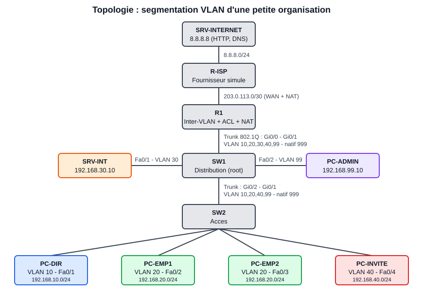
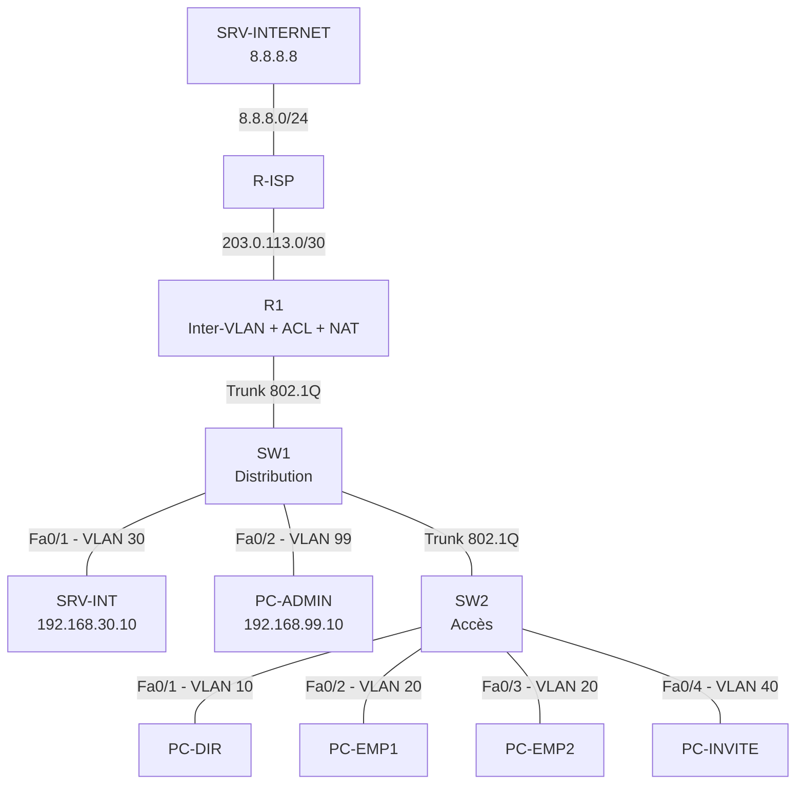

# 🛡️ Segmentation réseau sécurisée : VLAN, routage inter-VLAN, ACL et sécurité des switchs

Conception et validation, dans **Cisco Packet Tracer**, de la segmentation du réseau d'une petite organisation (type ONG) : VLAN, routage inter-VLAN, ACL de filtrage, NAT, durcissement des switchs et administration sécurisée par SSH.

> 🎥 Vidéo de démonstration : *(lien YouTube à ajouter après publication)*
> 📺 Chaîne : [@cyberprojects-antonio](https://www.youtube.com/@cyberprojects-antonio)



---

## 1. Objectifs

- Isoler les zones du réseau (direction, employés, serveurs, invités, administration).
- Appliquer le principe du **moindre privilège** entre les VLAN avec des ACL.
- Durcir les switchs : trunks, port-security, BPDU Guard, ports inutilisés.
- Restreindre l'administration des équipements au VLAN de management (SSH uniquement).
- **Valider** la segmentation avec un plan de tests reproductible.

**Hors périmètre de ce dépôt** : pfSense et WireGuard (pare-feu à états et VPN), qui feront l'objet d'un projet suivant. Packet Tracer ne les simule pas.

## 2. Topologie



### Matériel Packet Tracer

| Équipement | Modèle PT | Nom |
|---|---|---|
| Routeur passerelle | Router 2911 | R1 |
| Routeur FAI simulé | Router 2911 | R-ISP |
| Switchs | Switch 2960-24TT | SW1, SW2 |
| Serveurs | Server-PT | SRV-INT, SRV-INTERNET |
| Postes | PC-PT | PC-DIR, PC-EMP1, PC-EMP2, PC-INVITE, PC-ADMIN |

### Câblage

| De | Vers | Câble |
|---|---|---|
| R1 `Gi0/0` | SW1 `Gi0/1` | Droit (trunk) |
| SW1 `Gi0/2` | SW2 `Gi0/1` | Droit ou croisé (trunk) |
| SW1 `Fa0/1` | SRV-INT `Fa0` | Droit |
| SW1 `Fa0/2` | PC-ADMIN `Fa0` | Droit |
| SW2 `Fa0/1` à `Fa0/4` | PC-DIR, PC-EMP1, PC-EMP2, PC-INVITE | Droit |
| R1 `Gi0/1` | R-ISP `Gi0/0` | Croisé |
| R-ISP `Gi0/1` | SRV-INTERNET `Fa0` | Croisé |

## 3. Plan d'adressage

| VLAN | Nom | Réseau | Passerelle | Rôle |
|---|---|---|---|---|
| 10 | DIRECTION | 192.168.10.0/24 | .1 | Postes de direction (DHCP) |
| 20 | EMPLOYES | 192.168.20.0/24 | .1 | Postes du personnel (DHCP) |
| 30 | SERVEURS | 192.168.30.0/24 | .1 | SRV-INT = `192.168.30.10` (statique) |
| 40 | INVITES | 192.168.40.0/24 | .1 | Wi-Fi / postes invités (DHCP, DNS 8.8.8.8) |
| 99 | MGMT | 192.168.99.0/24 | .1 | R1 `.1`, SW1 `.2`, SW2 `.3`, PC-ADMIN `.10` (statique) |
| 666 | PARKING | — | — | Ports inutilisés (éteints) |
| 999 | NATIF-INUTILISE | — | — | VLAN natif des trunks |

WAN : R1 `203.0.113.2/30` ↔ R-ISP `203.0.113.1/30`. Réseau « Internet » : R-ISP `8.8.8.1/24`, SRV-INTERNET `8.8.8.8/24`.

## 4. Politique de sécurité (matrice de flux)

| Source ↓ / Destination → | DIRECTION | EMPLOYES | SERVEURS | INVITES | MGMT | Internet |
|---|:--:|:--:|:--:|:--:|:--:|:--:|
| **DIRECTION (10)** | — | ✅ | ✅ | ❌ | ❌ | ✅ |
| **EMPLOYES (20)** | ❌ | — | ✅ ICMP, DNS, HTTP, HTTPS, FTP | ❌ | ❌ | ✅ |
| **SERVEURS (30)** | ❌ | ❌ | — | ❌ | ❌ | ✅ |
| **INVITES (40)** | ❌ | ❌ | ❌ | — | ❌ | ✅ |
| **MGMT (99)** | ✅ | ✅ | ✅ | ✅ | — | ❌ (non NATé) |

Les ACL étendues sont appliquées **en entrée** sur chaque sous-interface de R1, au plus près de la source. Elles filtrent aussi l'usurpation d'adresse : seul le sous-réseau du VLAN peut émettre depuis son VLAN.

## 5. Étapes complètes de configuration

> 📘 **Guide détaillé, clic par clic, dans Packet Tracer : [`docs/guide-pas-a-pas-packet-tracer.md`](docs/guide-pas-a-pas-packet-tracer.md)** (placement des équipements, câblage, collage des configurations, hôtes, tests, simulation, port-security, dépannage). La liste ci-dessous en est le résumé.

> Les mots de passe des fichiers sont des **valeurs de démonstration pour le laboratoire**. Ne les réutilisez jamais en production.

### Étape 1 : construire la topologie
Placez les équipements et câblez-les selon la section 2. Mettez le fichier de travail dans `packet-tracer/`.

### Étape 2 : configurer R-ISP
Ouvrez la CLI de R-ISP et collez [`configs/R-ISP.txt`](configs/R-ISP.txt).

### Étape 3 : configurer les switchs
1. SW1 : collez [`configs/SW1.txt`](configs/SW1.txt).
2. SW2 : collez [`configs/SW2.txt`](configs/SW2.txt).
3. Vérifiez : `show vlan brief` et `show interfaces trunk`.

Ce que fait cette configuration : VLAN nommés, VTP transparent, Rapid-PVST avec SW1 racine, trunks limités aux VLAN utiles avec natif 999 et DTP désactivé, ports d'accès avec PortFast, BPDU Guard et port-security (1 MAC, mode sticky, violation `shutdown`), ports inutilisés dans le VLAN 666 et éteints.

### Étape 4 : configurer R1
Collez [`configs/R1.txt`](configs/R1.txt). Il contient les ACL, les sous-interfaces 802.1Q, le NAT, le DHCP et le durcissement SSH.
Vérifiez : `show ip interface brief`, `show ip route`, `show access-lists`.

### Étape 5 : configurer les hôtes
- **PC-ADMIN** : IP `192.168.99.10`, masque `255.255.255.0`, passerelle `192.168.99.1`, DNS `8.8.8.8`.
- **SRV-INT** : IP `192.168.30.10`, masque `255.255.255.0`, passerelle `192.168.30.1`, DNS `192.168.30.10`. Activez les services HTTP, HTTPS, DNS (par ex. `intranet.lab` → `192.168.30.10`) et FTP.
- **SRV-INTERNET** : IP `8.8.8.8`, masque `255.255.255.0`, passerelle `8.8.8.1`. Activez HTTP et DNS (par ex. `www.exemple.com` → `8.8.8.8`).
- **PC-DIR, PC-EMP1, PC-EMP2, PC-INVITE** : mode **DHCP**.

### Étape 6 : générer la clé SSH
Si `crypto key generate rsa modulus 2048` est refusé par votre version de Packet Tracer, tapez `crypto key generate rsa`, puis `2048` à l'invite.
Test depuis PC-ADMIN (Command Prompt) : `ssh -l admin 192.168.99.1`.

### Étape 7 : valider
Suivez [`tests/plan-de-tests.md`](tests/plan-de-tests.md) et enregistrez les résultats et captures d'écran (`screenshots/`). Utilisez le mode **Simulation** de Packet Tracer pour montrer visuellement le paquet rejeté par l'ACL.

### Étape 8 : sauvegarder
`write memory` sur chaque équipement, puis enregistrez `packet-tracer/segmentation-vlan.pkt`.

### Étape 9 (bonus) : DHCP snooping
Voir [`configs/bonus-dhcp-snooping.txt`](configs/bonus-dhcp-snooping.txt) (selon la version de Packet Tracer).

## 6. Tests réalisés

Résumé des scénarios (détail dans [`tests/plan-de-tests.md`](tests/plan-de-tests.md)) :

- Invité → réseau interne : bloqué. Invité → Internet : autorisé.
- Employé → serveur (ports autorisés) : autorisé. Employé → direction / administration : bloqué.
- Administration SSH uniquement depuis le VLAN 99 ; Telnet refusé.
- Port-security : un second équipement sur un port d'accès met le port en `err-disabled`.
- Trunks : VLAN natif 999, VLAN autorisés limités, DTP désactivé.

## 7. Limites et pistes d'amélioration

- Les ACL Cisco sont **sans état** : les retours sont autorisés par règles explicites (`established`, `echo-reply`), ce qui est moins précis qu'un pare-feu à états.
- Le routage inter-VLAN en *router-on-a-stick* est un point unique de défaillance et de débit ; un switch L3 serait préférable à plus grande échelle.
- Pas de 802.1X, de DAI ni de journalisation centralisée dans cette version.

**Suite du projet** : remplacer le filtrage par **pfSense** (pare-feu à états), ajouter un accès distant **WireGuard**, puis envoyer les journaux vers **Wazuh**.

## 8. Structure du dépôt

```
.
├── README.md
├── LICENSE
├── configs/            # Configurations des équipements (à coller dans la CLI)
├── docs/               # Guide pas à pas, schéma de topologie, fiche vidéo
├── packet-tracer/      # Fichier .pkt du laboratoire
├── screenshots/        # Captures d'écran des tests
└── tests/              # Plan de tests
```

## 9. Avertissement

Projet pédagogique réalisé en laboratoire simulé. Les mots de passe et adresses sont fictifs. N'effectuez des tests de sécurité que sur vos propres équipements ou avec autorisation écrite.

## 10. Auteur

**Faly Jean Antonio Downavan ANDRIATSITOHAINA** — Analyste SOC & Ingénieur Cybersécurité
GitHub : [df-x-strike](https://github.com/df-x-strike) · YouTube : [@cyberprojects-antonio](https://www.youtube.com/@cyberprojects-antonio) · [LinkedIn](https://www.linkedin.com/in/faly-jean-antonio-downavan-andriatsitohaina-00321a3b1) · [Portfolio](https://df-x-strike.github.io/)

Lien vidéo sur ma chaîne Youtube : https://youtu.be/qitwr65YH8A
